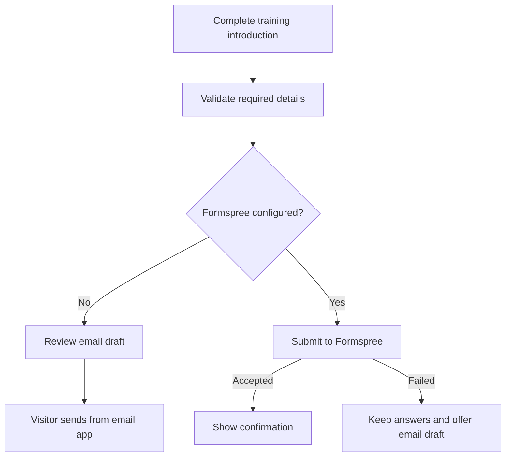

# Client training introductions

The `/contact` page collects contact preferences, client or guardian details,
goals, training experience, sport, coaching interest, schedule, equipment,
start timeline, and optional context. Medical history is intentionally excluded.
Required fields and conditional phone/guardian fields are validated before submission.

## Email draft mode

Without Formspree, **Prepare my introduction** creates a readable summary locally.
Nothing is sent automatically. Visitors can review, download, and open an email
draft addressed to Brock. Long introductions remain fully available to copy into
the email rather than being silently truncated in a long mailto URL.

## Enable direct delivery

1. Create a Formspree form and verify the recipient email.
2. Copy `.env.example` to `.env` locally.
3. Set `PUBLIC_FORMSPREE_ID` to the form ID, such as `abcdefgh` (not a URL).
4. Set the same build variable in Vercel, then rebuild and deploy.
5. Send a test introduction and confirm both the success message and receipt.

Delivery includes a 15-second timeout, spam trap, sending state, and accessible
status message. Failed submissions preserve answers. A successful submission
clears them. An under-18 inquiry requests a parent or guardian's contact details.

Formspree's form ID is public configuration. Never commit `.env`. Use the
Formspree dashboard for spam controls and submissions. Review the privacy page
before enabling direct delivery. No inquiry answers are stored in the browser.

[All documentation](README.md)
