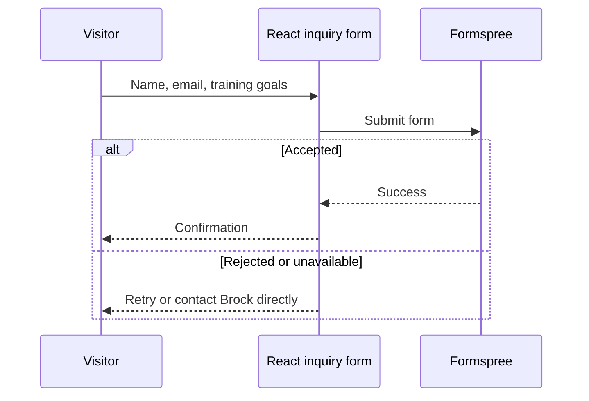

# Enable website inquiries

The site works without Formspree: visitors can call, text, email, or use Instagram.
No placeholder form is shown when the configuration is absent.

1. Create a Formspree form and verify the recipient email.
2. Copy `.env.example` to `.env` locally.
3. Set `PUBLIC_FORMSPREE_ID` to the form ID, such as `abcdefgh` (not the full URL).
4. Set the same variable in the deployment provider's build environment.
5. Rebuild and deploy. Public Astro variables are resolved at build time.
6. Send a real test inquiry and confirm both the success message and email receipt.

The form includes native required-field/email checks, an invisible spam trap,
a sending state, an accessible status message, and a visible error fallback.
The form ID is public configuration, not a secret. Never commit `.env` files.
Use Formspree's dashboard for spam controls and submissions. Do not collect
medical information in the form. Review the privacy page before enabling it.

[All documentation](README.md)
