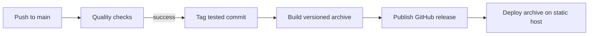

# Deployment and releases

The site is static. Use any host that can serve `dist/` with directory index
support. Configure Node 24, install with `bun install --frozen-lockfile`, build
with `bun run build`, and publish `dist/`. No application server or database is
required. Set the optional Formspree variable before building.

Deploy at the domain root. If deploying under a subdirectory, configure Astro's
base and update root-relative links first. Configure the host to serve `404.html`
for missing routes. HTTPS should be enabled by the hosting provider.

## Automatic releases

Successful push-triggered CI on `main` starts automatic patch releases, beginning
at `v0.1.0`. The auto-release workflow tags the exact tested commit and dispatches
the release workflow. Pull-request CI cannot trigger a release. Already-tagged
commits are skipped. Releases contain `bold-performance.tar.gz` with the static
site; publishing a GitHub release does not itself deploy a website.

The release workflow can be rerun with an existing version tag. It verifies the
tag format and replaces the corresponding archive on an existing release.
Actions are pinned to commit SHAs. Dependabot proposes dependency and Action updates.

Before a production launch, confirm Brock's copy, contact details, training
locations, and privacy policy. If enabling Formspree, verify delivery. Check the
public URL on desktop and mobile after deployment.

[All documentation](README.md)
