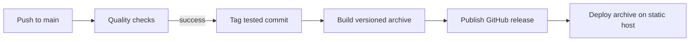

# Deployment and releases

## Vercel

The Vercel project is `bold-performance` in Nicholas Adamou's projects, connected
to the public `smeltery/bold-performance` repository. Pushes to `main` create
production deployments; pull requests get preview deployments. Vercel deployment
and GitHub quality checks run independently, so verify both before sharing a release.

`vercel.json` configures Astro, `bun install --frozen-lockfile`, `bun run build`,
and the `dist/` output directory. Node 24 is declared in `package.json`. Security
headers prevent framing and MIME sniffing and set a cross-origin referrer policy.

Set `PUBLIC_FORMSPREE_ID` in Vercel's project environment variables before
rebuilding to enable the inquiry form. No server, database, or runtime secret is
needed. Add a custom domain in the Vercel dashboard when available.

For a manual production deploy after checking changes:

```sh
vercel --prod --scope nicholas-adamous-projects
```

The site can also be hosted at the root of another static host. Publish `dist/`,
serve directory indexes, and use `404.html` for missing routes. Configure Astro's
base and root-relative links before deploying under a subdirectory.

## Automatic releases



Successful push-triggered CI on `main` starts automatic patch releases, beginning
at `v0.1.0`. The auto-release workflow tags the exact tested commit and dispatches
the release workflow. Pull-request CI cannot trigger a release. Already-tagged
commits are skipped. Releases contain `bold-performance.tar.gz` with the static
site; publishing a GitHub release does not itself deploy a website.

The release workflow can be rerun with an existing version tag. It verifies the
tag format and replaces the corresponding archive on an existing release.
Actions are pinned to commit SHAs. Dependabot proposes dependency and Action updates.

Before a production launch, confirm Brock's copy, contact details, training
locations, and privacy policy. If enabling Formspree, verify delivery. Check the
public URL on desktop and mobile after deployment.

[All documentation](README.md)
