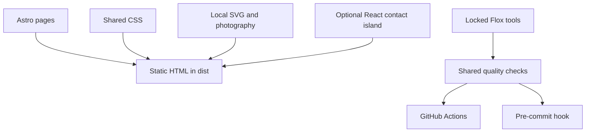

# Development

Install Flox, then run these commands from the repository:

```sh
flox activate
bun install --frozen-lockfile
bun run dev
```

Flox locks Bun 1.3.11, Node 24, Git, and actionlint across macOS and Linux on
ARM64 and x86-64. Activation installs the repository's Git pre-commit hook.
Use `flox activate --start-services` to manage the preview as a Flox service;
`flox services stop preview` stops it.



## Commands and checks

| Command              | Purpose                                                                                         |
| -------------------- | ----------------------------------------------------------------------------------------------- |
| `bun run dev`        | Local development server                                                                        |
| `bun run format`     | Format source and documentation                                                                 |
| `./scripts/check.sh` | Formatting, Markdown, Mermaid, links, budgets, types, tests, build, asset/link crawl, workflows |
| `bun run build`      | Generate the static site                                                                        |
| `bun run preview`    | Serve the production build locally                                                              |

CI and pre-commit both execute `scripts/check.sh` inside Flox. Dependencies are
locked in `bun.lock`. Run `bun install` after dependency changes and commit the lock.

Budgets in `scripts/budgets.json` allow 250 lines per source/documentation file,
20 direct files per directory, and 6,800 total checked lines. Generated assets,
lockfiles, dependencies, and Flox-generated files are excluded. The validator reads
tracked files, so stage new files before running the full check. Split by
responsibility, not to satisfy arbitrary line counts.

Browser QA uses Maestri portals. Check 1440px desktop and 390px mobile layouts,
menu focus containment, open/close and Escape, FAQ toggles, section anchors, overflow, and contact
links. Test the optional form with a temporary ID and mocked network responses;
only a verified recipient test proves real email delivery.

[All documentation](README.md)
