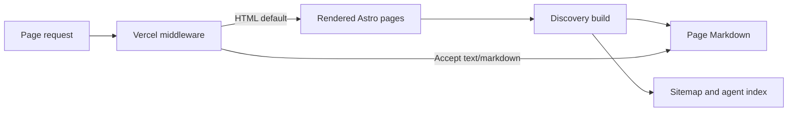

# Search, agents, and analytics

Every page has a canonical URL, description, social preview, and JSON-LD describing
Bold Performance and Brock. The production origin lives in `src/content/site.ts`
and `astro.config.mjs`; update both if the primary domain changes.

## Agent access

The build generates `robots.txt`, `sitemap.xml`, `llms.txt`, and `llms-full.txt`.
The sitemap includes public pages and tool URLs; the 404 page is not indexed.
Markdown is generated from the same rendered content visitors read, keeping tool
guides and coaching details in sync. The index explains when to use the site and
how inquiries work. Calculators run locally; there is no booking or payment API.



Vercel middleware negotiates `Accept: text/markdown` on page URLs, sets
`Vary: Accept`, and returns helpful Markdown 404s for missing pages. Local Astro
preview serves the generated `/agent-content/*.md` files directly; negotiation
requires Vercel. Verify production with:

```sh
curl -i -H 'Accept: text/markdown' https://bold-performance.vercel.app/
curl -i -H 'Accept: text/html' https://bold-performance.vercel.app/
curl -i -H 'Accept: text/markdown' https://bold-performance.vercel.app/missing-page
```

Use [Is Agentic](https://is-agentic.com/scan/bold-performance.vercel.app) to audit
the public deployment. Search rankings depend on indexing and external signals;
technical metadata cannot guarantee a ranking or a particular audit score.

## Vercel Web Analytics

The shared layout includes Vercel's Astro analytics component. Enable Web
Analytics for this project in Vercel and redeploy when changing its configuration.
It measures page views; no custom events collect intake answers or tool inputs.
The privacy page describes the integration. View results in the project's
Vercel Web Analytics dashboard. Browser blockers can prevent some visits from
being counted.

## Social preview

`public/assets/og-image.png` is a 1200 × 630 hero-inspired image shared by all
pages. It also appears in the README. Run `bun run og` to regenerate it after
editing `scripts/generate-og.ts`. The renderer uses local brand artwork, the
credited hero photograph, and bundled Barlow Condensed / DM Sans fonts under
their accompanying SIL Open Font Licenses. Commit the generated PNG.

[All documentation](README.md)
