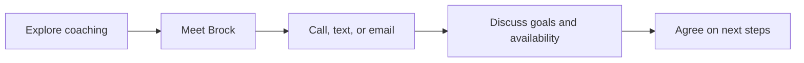

# Find your next step

Bold Performance introduces personalized training with Brock Jones in Scottsdale.
Explore the three coaching focus areas, meet Brock, and review how to get started.
Pricing, training locations, and availability are discussed directly with Brock.

Use **Start your journey** to open the detailed training introduction. On mobile, **Menu** opens
links to the main pages; select a link or press Escape to close it. The menu keeps keyboard focus inside while open. FAQs expand when selected.
Keyboard users can use the skip link to reach the main content.

Calls, texts, and emails open the appropriate application on your device.
Instagram opens Brock's profile. If the inquiry form is enabled, a confirmation
appears only after Formspree accepts the submission; errors offer direct contact.

[All documentation](README.md)

Use [Training tools](tools.md) to browse 14 tools for workouts, strength, conditioning,
and nutrition. Search by name or filter by category; each tool has its own shareable URL.
Press **Cmd+K** on Mac or **Ctrl+K** on other keyboards to search pages and tools.
Use arrow keys to move through results, Enter to open one, and Escape to close search.

The training introduction collects your goals, experience, preferred coaching, and
availability. Without direct form delivery configured, review the generated introduction
and send it through your email app. You can also download a copy. Nothing is sent automatically.

FAQs use expandable cards that work with the keyboard. The mobile menu includes
the brand logo, page links, coaching context, and a link to the training introduction.
Supported browsers use a short blur between pages; reduced-motion settings disable it.
